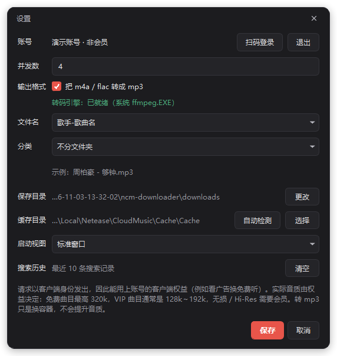
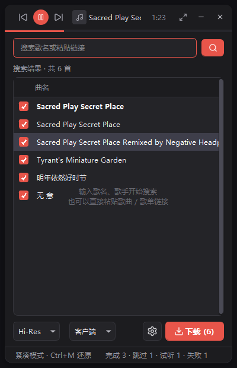
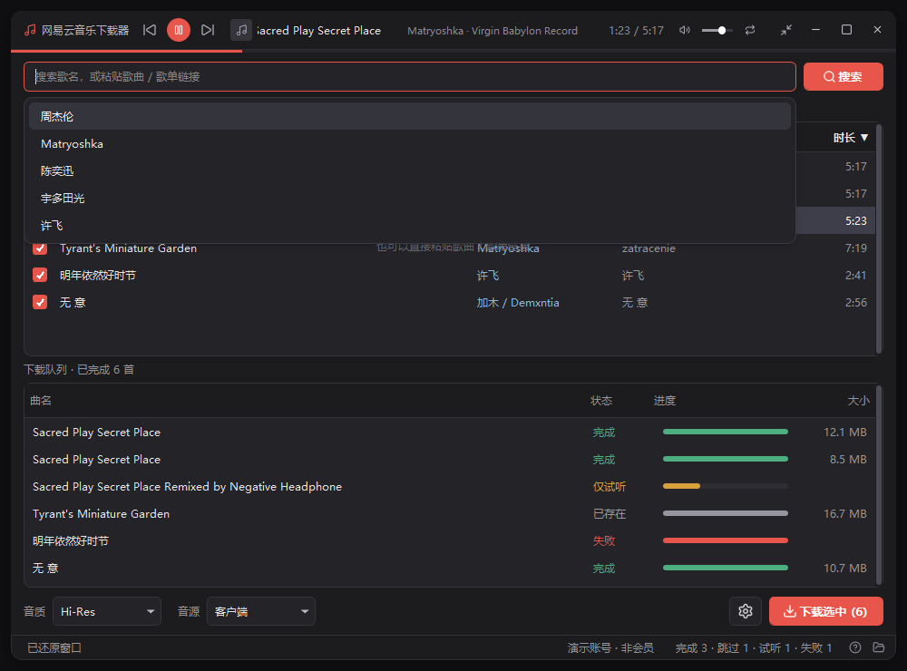
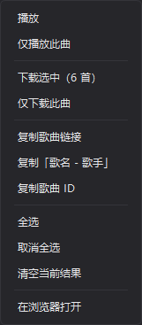

# 网易云音乐下载器

Windows 桌面端下载工具：搜索、试听、下载、读取客户端缓存。PyQt5 自绘无边框界面，支持批量下载与多种命名模板。


## 功能

- **三种音源**：客户端接口（可用账号的客户端权益）、网页接口、仅本地缓存
- **音质选择**：标准 / 较高 / 极高 / 无损 / Hi-Res，实际档位由账号权益决定
- **批量下载**：勾选后一键下载，支持取消单首、失败重试、断点续传
- **内置播放器**：双击播放、空格暂停、循环模式、音量调节
- **本地缓存列表**：自动识别客户端缓存目录，边听边刷新
- **命名模板**：`歌手-曲名`、`曲名` 等多种格式，可按歌手 / 专辑分文件夹
- **转码**：可选把 m4a / flac 转成 mp3，内置 ffmpeg
- **搜索结果翻页**：一次 50 条，可继续加载
- **运行日志**：出问题时可查 `%USERPROFILE%\.ncm-downloader\app.log`

## 直接使用

下载 `网易云下载器.exe`（单文件，约 88 MB），双击运行。无需安装 Python 或 ffmpeg。

首次建议：

1. 设置里扫码登录，解锁更高音质与客户端权益
2. 选择保存目录、音质档位
3. 输入歌名或粘贴歌曲 / 歌单链接搜索

## 从源码运行

```bash
pip install -r requirements.txt
python run_gui.py          # 图形界面
python -m ncm --help       # 命令行
```

需要 Python 3.10+，Windows 10 / 11。

## 打包

```bash
python -m PyInstaller --noconfirm --onefile --windowed \
  --name "网易云下载器" --icon "gui/assets/app.ico" \
  --add-data "gui/assets;gui/assets" \
  --add-binary "<site-packages>/imageio_ffmpeg/binaries/ffmpeg-win-x86_64-v9.0.2.exe;imageio_ffmpeg/binaries" \
  --hidden-import PyQt5.QtMultimedia --hidden-import PyQt5.QtMultimediaWidgets \
  run_gui.py
```

`--add-binary` 那行不能省：`--collect-all imageio_ffmpeg` 只收 Python 模块，不带 ffmpeg 二进制，漏了转码功能在别人机器上就是坏的。

> Nuitka 在当前环境不可用，原因见 [docs/MAINTENANCE.md](docs/MAINTENANCE.md#打包踩坑)。

## 文档

| 文档 | 内容 |
|---|---|
| [docs/ARCHITECTURE.md](docs/ARCHITECTURE.md) | 模块划分、数据流、关键类 |
| [docs/DEVELOPMENT.md](docs/DEVELOPMENT.md) | 开发环境、代码约定、调试与测试 |
| [docs/MAINTENANCE.md](docs/MAINTENANCE.md) | 维护手册：已知坑、接口变动、发布流程 |
| [CHANGELOG.md](CHANGELOG.md) | 版本记录 |

## 界面

| 设置 | 紧凑模式 |
|---|---|
|  |  |

| 搜索历史 | 右键菜单 |
|---|---|
|  |  |

## 常见问题

**VIP 歌曲下载失败或只有试听片段？**
先确认设置里已登录。移动端开过「免费听歌」后，桌面端也能拿到完整版；否则按账号权益降级。

**缓存列表是空的？**
需要先用网易云客户端播放过几首歌。本工具只读取已缓存的内容，不会触发播放或下载。

**客户端改过缓存位置？**
到「设置 → 缓存目录」手动指定。

**转码失败？**
工具内置 ffmpeg，一般不需要额外安装；失败时检查文件名是否含特殊字符。

## 说明

本项目仅用于个人学习与技术研究。下载内容请自行确认拥有相应权限，勿用于传播或商业用途。使用本工具产生的后果由使用者承担。

## 联系方式

- 网站：https://mochizuki.top
- 邮箱：nagi@mochizuki.top
