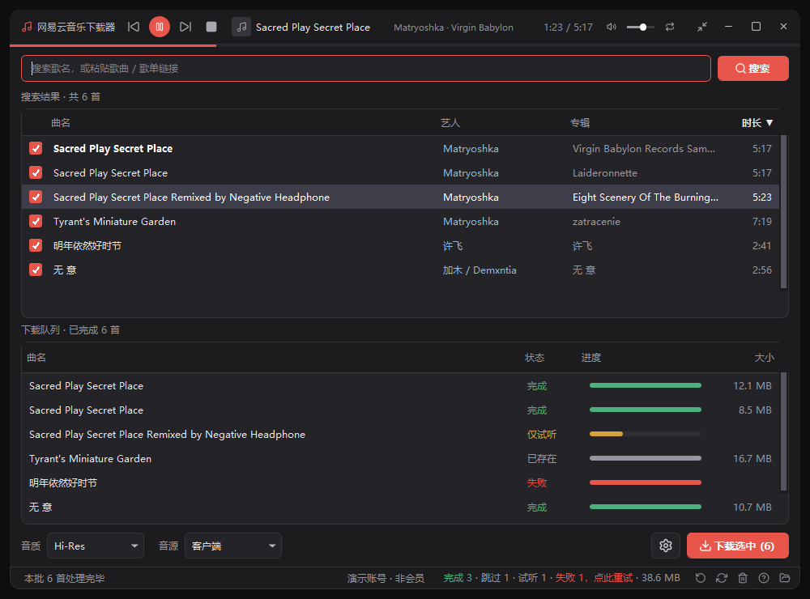

# 网易云音乐下载器

Windows 桌面端下载工具：搜索、试听、下载、读取客户端缓存。PyQt5 自绘无边框界面，
自带命令行入口和开发者面板。



## 功能

**下载**

- **三种音源**：客户端接口（可用账号的客户端权益）、网页接口、仅本地缓存
- **音质选择**：标准 / 较高 / 极高 / 无损 / Hi-Res，实际档位由账号权益决定
- **批量下载**：勾选后一键下载，支持取消单首、整批暂停后从主按钮继续、失败重试、断点续传
- **命名模板**：`歌手-曲名`、`曲名` 等，可按歌手 / 专辑分文件夹
- **转码**：可选把 m4a / flac 转成 mp3，用内置 ffmpeg
- **搜索结果翻页**：一次 50 条，可继续加载

**播放**

- **内置播放器**：双击播放、空格暂停、循环模式、音量调节
- **后端自动选对**：优先走系统自带的 Media Foundation 解码器，m4a / flac / mp3 / wav
  直接播放，不需要额外装解码器
- **兼容播放（默认关闭）**：系统确实放不了的格式，可开启后用内置 ffmpeg 无损转成 WAV 再播；
  关闭时只提示并给出开启入口，不会擅自转换
- **状态区分**：「获取中 / 缓冲中 / 正在播放」，联网补齐时显示下载进度

**缓存**

- **本地缓存列表**：自动识别客户端缓存目录，默认最新缓存置顶，开启自动刷新后跟进客户端
- **缓存存档**：可选把听过的留下，更高码率的版本会替换旧的
- **一键切换**：时间 / 曲名排序

**界面**

- 自适应列表：窗口变窄自动切紧凑模式（曲名双行、时长并音质、进度常驻），`Ctrl+M` 切换
- 托盘常驻：最小化收进托盘，菜单控制播放，支持媒体键，悬停显示当前曲目
- 下载速度与剩余时间显示在状态栏

## 直接使用

从发布页下载 `网易云下载器-vX.X.X-win64.zip`，解压后双击里面的「网易云下载器.exe」。
无需安装 Python 或 ffmpeg。

升级：解压新版本，把旧目录的 `config.json`、`settings.ini` 复制过去即可保留登录状态与设置。

首次建议：

1. 设置里扫码登录，解锁更高音质与客户端权益
2. 选择保存目录、音质档位
3. 输入歌名或粘贴歌曲 / 歌单链接搜索

## 命令行：不开界面直接下载

程序目录下的 `ncm-dl.bat` 是命令行入口，搜索、下载、导出缓存都不需要启动图形界面。
脚本会自动挑一个装好依赖的 Python，缺依赖时自动安装（命令行不要求 PyQt5）。

```bash
ncm-dl.bat search "关键词" -n 10        # 搜索
ncm-dl.bat dl 26093064                  # 下载单曲
ncm-dl.bat dl "歌单或专辑链接"          # 下载整个歌单 / 专辑
ncm-dl.bat dl 26093064 -q lossless      # 指定音质（standard/higher/exhigh/lossless/hires）
ncm-dl.bat dl 26093064 --to-mp3         # 顺带转成 mp3
ncm-dl.bat url 26093064                 # 只看播放地址与实际码率
ncm-dl.bat cache                        # 把客户端播放缓存解码成文件
ncm-dl.bat whoami                       # 登录态与各音源权限
```

- 不传 `-q`（音质）、`-o`（目录）、`-t`（命名模板）时**跟随图形界面里的设置**，
  两个入口共用同一份下载记录，同一首歌不会被下载两遍。
- 加 `--json` 后 stdout 只有一行 JSON（搜索结果、每个文件的完整路径与状态），
  过程提示全部走 stderr；失败时同样输出 `{"ok": false, "error": "..."}`，
  可以直接被脚本、自动化工具解析。

## 开发者面板

入口在**设置 → 开发者 → 开发者面板**，不占主界面。窗口和主界面同一套外观，右下角可拉伸。

| 页面 | 内容 |
|---|---|
| 状态 | 播放器进度与来源、任务进度、队列每首的实时进度条、最近 5 分钟内的错误 |
| 日志 | 实时日志，按级别 / 关键字过滤，可暂停（暂停期间的数据不会丢） |
| 问题 | 只收警告与错误，点一条看完整内容；导航按钮上有错误时变红 |
| 组件 | 换 ffmpeg、切播放后端（重启生效）、开关兼容播放、查看本机放不了的格式 |
| 指令 | 命令台，改设置、跑扫描、查取址、导诊断包 |
| 环境 | 完整路径、缓存统计、磁盘剩余、全部配置项（敏感字段打码） |

左侧是**流程时间线**：搜索 / 缓存 / 下载 / 播放的每一步，带范围、结果、耗时，
下载批次按歌折叠。可按范围筛、只看失败、导入 `steps.txt` 离线回放别人的现场。

常用指令：

```
help                    列出全部命令
status                  打印状态页内容
url 585404              查这首歌的取址结果（格式 / 码率 / 大小）
cache clear             清空播放缓存
compat on|off           开关兼容播放
source client|web|cache 切换音源
diag                    导出诊断包
```

导航行最右的 **?** 按钮是内置帮助，49 条说明覆盖每个页面、按钮和指令，顶部搜索框
按功能名、按钮名、页面名都能筛。

出问题时的标准动作：打开面板 → 复现一次 → 右下角「导出诊断包」，把 zip 发出来即可。
包里有环境、配置（已脱敏）、流程步骤、错误和日志尾部。

## 从源码运行

```bash
pip install -r requirements.txt
python run_gui.py          # 图形界面
python -m ncm --help       # 命令行
```

需要 Python 3.10+，Windows 10 / 11。

## 打包

产出的是**文件夹版**，不是单文件：依赖和 ffmpeg 都摆在明处，启动也更快（不用每次解压到临时目录）。

```bash
python -m PyInstaller --noconfirm --onedir --windowed \
  --name "网易云下载器" --icon "gui/assets/app.ico" \
  --add-data "gui/assets;gui/assets" \
  --hidden-import PyQt5.QtMultimedia --hidden-import PyQt5.QtMultimediaWidgets \
  --distpath pack --workpath pack_build \
  run_gui.py

# 打包后把 ffmpeg 摆到 exe 同级，程序会优先用这份
mkdir "pack\网易云下载器\ffmpeg\binaries"
copy "<site-packages>\imageio_ffmpeg\binaries\ffmpeg-win-x86_64-v9.0.2.exe" "pack\网易云下载器\ffmpeg\binaries\"
```

成品结构：

```
pack\网易云下载器\
├── 网易云下载器.exe
├── ffmpeg\binaries\ffmpeg-win-x86_64-v9.0.2.exe   转码用，可删
├── _internal\                                     依赖库，勿动
└── 使用说明.txt
```

`build.bat` 一条命令做完上面的事，`python tools/make_zip.py` 打成发布用的 zip。

> 也可以用 `--onefile` 打单文件，但那样每次启动都要把 190 MB 解压到 `%TEMP%`，
> 启动慢、出问题也不容易看。目录版更适合分发与排错。

> Nuitka 在当前环境不可用，原因见 [docs/MAINTENANCE.md](docs/MAINTENANCE.md#打包踩坑)。

## 文档

| 文档 | 内容 |
|---|---|
| [docs/ARCHITECTURE.md](docs/ARCHITECTURE.md) | 模块划分、数据流、关键类 |
| [docs/DEVELOPMENT.md](docs/DEVELOPMENT.md) | 开发环境、代码约定、调试与测试 |
| [docs/MAINTENANCE.md](docs/MAINTENANCE.md) | 维护手册：已知坑、接口变动、发布流程 |
| [CHANGELOG.md](CHANGELOG.md) | 版本记录 |

## 界面

| 设置 | 紧凑模式 |
|---|---|
|  |  |

| 搜索历史 | 右键菜单 |
|---|---|
|  |  |

## 常见问题

**播放没声音，或者提示「无法直接播放」？**
先在开发者面板的「状态」页看那行「无法直接播放：是/否」。是的话两种选择：换一台系统解码器
齐全的机器（Win10/11 标准版都有），或者到设置里开「兼容播放」，用内置 ffmpeg 转成 WAV 播放。

**缓存列表是空的？**
需要先用网易云客户端播放过几首歌。本工具只读取已缓存的内容，不会触发播放或下载。

**客户端改过缓存位置？**
到「设置 → 缓存目录」手动指定。

**VIP 歌曲下载失败或只有试听片段？**
先确认设置里已登录。移动端开过「免费听歌」后，桌面端也能拿到完整版；否则按账号权益降级。

**转码失败？**
工具内置 ffmpeg，一般不需要额外安装。可以到开发者面板「组件」页点「测试」看 ffmpeg
是否正常，必要时手动指定一个 ffmpeg.exe。

**想让它自动下载，不想开界面？**
用 `ncm-dl.bat`，加 `--json` 后输出可被程序解析。见上面「命令行」一节。

## 文件存在哪

**便携模式：所有数据都在程序自己的文件夹里**，不写注册表，不碰用户目录。

| 内容 | 位置 |
|---|---|
| 登录状态、缓存目录等配置 | `config.json` |
| 界面偏好（音质、并发、列宽、搜索历史） | `settings.ini` |
| 运行日志 / 崩溃日志 | `app.log` / `crash.log` |
| 播放缓存（解密出的音频） | `play-cache\`（设置里可清理） |
| 默认下载目录 | `downloads\`（设置里可改） |
| 已下载索引 | `<下载目录>\.ncm-index.db` |
| 诊断包 | `diagnostics\`（开发者面板导出） |

拷走整个文件夹就等于带走全部状态；删掉文件夹就是卸载干净。

只有一处例外：程序启动时会**读取**网易云客户端的缓存目录（`缓存目录` 那一项），
那是别人的数据，只读不改。

## 说明

本项目仅用于个人学习与技术研究。下载内容请自行确认拥有相应权限，勿用于传播或商业用途。
使用本工具产生的后果由使用者承担。

## 联系方式

- 网站：https://mochizuki.top
- 邮箱：nagi@mochizuki.top
